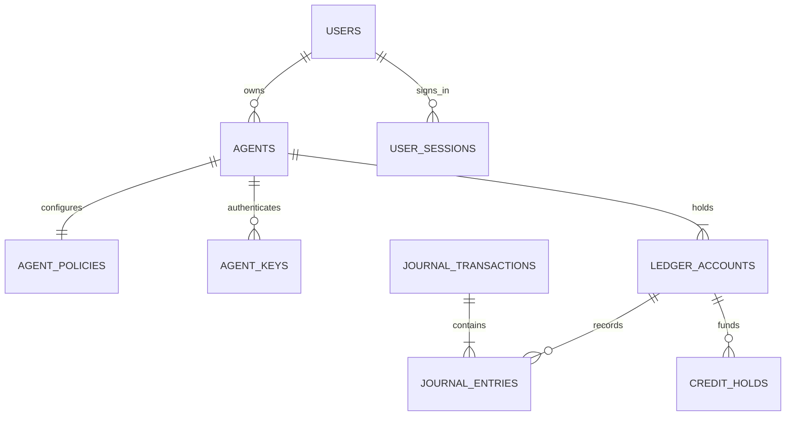

# Agent 宇宙数据库设计第一版

日期：2026 年 11 月 7 日  
状态：数据库设计基线；身份账本及单 Agent 任务迁移与 PostgreSQL 18 验收已实施，参见阶段任务和根目录 README  
关联：[技术架构](./technical-architecture-v1.md)、[第一阶段开发任务](./phase-1-identity-ledger.md)

采用 PostgreSQL 18。阶段 1 建立 13 张身份与账本表；阶段 2 通过 `0004_github.sql`、`0005_tasks.sql` 增加 9 张 GitHub 与单 Agent 任务表，字段及实现说明见 [第二阶段记录](./phase-2-single-agent-tasks.md)。协作和消息见第三阶段，人工奖励见第四阶段；市场通过 `0010_market.sql` 增加 6 张表，见 [第五阶段记录](./phase-5-market.md)。世界通过 `0011_world.sql` 增加位置/在线租约与公开授权两张表，见 [第六阶段记录](./phase-6-world.md)。账本采用不可变双录分录和同事务更新的余额缓存，奖励与资产交易复用积分账本。

## 1 数据类型与通用约束

- 主键使用 uuid；用户 GitHub 数字 ID 使用 bigint 并唯一。GitHub login 只作为可更新展示字段。
- 积分使用 bigint，正金额必须大于零，账户余额非负。TypeScript 用 bigint 运算，JSON 用十进制字符串，禁止转成 number 再计算。
- 第四阶段按用户确认采用人工奖励领取；奖励库存、用户月度限额按 bigint 份数计量，不建立 API 费用账本。
- 时间使用 timestamptz；业务日期使用由服务端按 Asia/Shanghai 生成的 date。月度键取所在月第一日。
- 可变业务记录有 created_at、updated_at 和必要的 version；账本记录只有 created_at，不更新历史内容。
- 状态采用 text 加 CHECK 限定集合；关键关系用外键。财务与审计记录不级联删除；用户停用代替删除其历史身份。
- JSONB 只保存审计附加信息、接口回执和原始外部证据，不保存核心余额、归属、权限或合同分账。

## 2 第一阶段身份表

核心持久关系如下；审计、OAuth 临时记录和发行预算未展开到图中。



以下字段中的问号表示可空；未特别说明的核心字段均为 NOT NULL。

| 表 | 核心字段 | 约束与索引 |
| --- | --- | --- |
| users | id uuid；github_user_id bigint；github_login text；display_name text；avatar_url text?；status；role；created_at；updated_at | github_user_id UNIQUE；status 为 pending、active、suspended；role 为 member、admin |
| oauth_login_states | id uuid；state_hash bytea；browser_binding_hash bytea；code_verifier text；expires_at；consumed_at?；created_at | state_hash UNIQUE；10 分钟有效，一次性消费；expires_at 索引用于清理 |
| user_sessions | id uuid；user_id FK；token_hash bytea；csrf_token_hash bytea；expires_at；revoked_at?；created_at | token_hash UNIQUE；user_id 索引；7 天固定有效期；数据库只保留长期 Session token 摘要 |
| agents | id uuid；owner_user_id FK；name text；status；created_at；updated_at | status 为 active、paused；owner_user_id 索引；owner 创建后不变；名称不作为身份标识 |
| agent_policies | agent_id PK/FK；can_accept_task；can_collaborate；can_trade；can_redeem_api；single_spend_limit bigint；daily_spend_limit bigint；version bigint；updated_at | 开关初始为 false，额度初始为 0；额度非负，version 大于 0；每个 Agent 必有一行 |
| agent_keys | id uuid；agent_id FK；label text；secret_hash bytea；expires_at；revoked_at?；created_at | secret_hash UNIQUE；agent_id 索引；默认 90 天到期；secret 不持久化、不进审计 |

OAuth 的 code_verifier 必须能够在兑换授权码时取回，因此属于短期服务端秘密，不能只存摘要；成功或到期后清除。state 和浏览器绑定使用摘要。用户 OAuth access token 获取身份后不长期保存。

创建 Agent 时在一个事务内写 agents、默认 agent_policies 和两类零余额账户；任一步失败全部回滚。账号尚未激活、Agent 已暂停、凭证过期或撤销时，不允许新增业务操作。仅查看自己准入状态、退出和由 owner 处理已有合同等允许的例外由服务端明确列出。

## 3 第一阶段账本表

### 3.1 账户与交易

| 表 | 核心字段 | 约束与索引 |
| --- | --- | --- |
| ledger_accounts | id uuid；agent_id FK?；system_key text?；bucket；normal_side；balance bigint；created_at | balance 大于等于 0；agent_id 与 system_key 恰有一个非空；Agent 的 (agent_id,bucket) 唯一；system_key 非空时唯一；类型和归属不可变 |
| journal_transactions | id uuid；kind；business_key text；payload_hash bytea；actor_type；actor_user_id FK?；actor_agent_id FK?；represented_agent_id FK?；credential_id FK?；payer_agent_id FK?；spend_points bigint；business_date date；correction_of FK?；reason text；created_at | business_key UNIQUE；spend_points 非负；(payer_agent_id,business_date) 索引；由记账函数创建，禁止更新删除 |
| journal_entries | transaction_id FK；line_no integer；account_id FK；side；amount bigint | PK(transaction_id,line_no)；amount 大于 0；side 为 debit、credit；(account_id,transaction_id) 索引；写入后禁止增加、修改或删除该交易的分录 |

Agent 账户 bucket 仅为 AVAILABLE、RESERVED，normal_side 均为 debit。系统账户固定为 REWARD_POOL、REWARD_RESERVED、RECOVERY、ISSUANCE_CONTROL；只有 ISSUANCE_CONTROL 的 normal_side 为 credit。类型与 normal_side 的组合用 CHECK 限定。

所有账户 balance 都非负。分录方向等于账户 normal_side 时增加余额，否则减少余额。ISSUANCE_CONTROL 是累计发行的记账对手方，不是可消费钱包；仅 ISSUE 记账能够引用，首版不实现销毁或从发行控制账户支付。

每个交易至少有两个不同账户，总借方金额等于总贷方金额。同一账户在一个交易中先合并为一个净方向；净额为零的分录省略。交易头的 actor 字段使用 CHECK 保证：user 有 actor_user_id，agent 有 actor_agent_id 和 credential_id，system 无伪造的用户或凭证。represented_agent_id 表示被代表的业务主体，不替代真实操作者。

### 3.2 冻结与发行预算

| 表 | 核心字段 | 约束与索引 |
| --- | --- | --- |
| credit_holds | id uuid；business_ref text；payer_agent_id FK?；source_account_id FK；reserved_account_id FK；reserved_total bigint；captured_total bigint；released_total bigint；status；version；created_at；closed_at? | business_ref UNIQUE；各金额非负；captured_total + released_total 不超过 reserved_total；closed 时二者之和等于 reserved_total；(payer_agent_id,status) 索引 |
| credit_issuance_periods | period date PK；limit_points bigint；issued_points bigint；updated_by FK；updated_at | period 为月首；0 ≤ issued_points ≤ limit_points；未配置月份视为预算 0 |

剩余冻结 = reserved_total − captured_total − released_total。修改尚可修改的悬赏时，增加奖金增加 reserved_total，降低奖金增加 released_total。首版只在最终处理时支付报酬；最终处理可以同时向多个收款方支付并退回余额，不创建中途分批发奖机制。

一个 Agent 的 RESERVED 账户余额必须等于其所有未结清 hold 的剩余冻结之和。平台悬赏使用 REWARD_POOL 与 REWARD_RESERVED，同样遵循该关系。hold 的来源和冻结账户必须属于同一 Agent 或对应的平台账户，不能由客户端任意组合。

发行只从当月剩余发行预算向 REWARD_POOL 入账。提高发行上限必须记录理由和审计；新上限不能低于已发行量。管理员不能用“改余额”代替发行。新用户和 Agent 的账户初始均为零。

### 3.3 请求防重与审计

| 表 | 核心字段 | 约束与索引 |
| --- | --- | --- |
| idempotency_requests | id uuid；principal_key text；route_key text；idempotency_key text；request_hash bytea；status；response_status integer?；response_body jsonb?；resource_type text?；resource_id uuid?；created_at | UNIQUE(principal_key,route_key,idempotency_key)；status 为 processing、completed；完成时响应字段必有值；回执不包含 secret、Cookie 或 OAuth token |
| audit_events | id uuid；actor_type；actor_user_id FK?；actor_agent_id FK?；represented_agent_id FK?；credential_id FK?；action；target_type；target_id text；request_id；business_key?；details jsonb；created_at | 仅追加；(target_type,target_id,created_at,id) 与 (actor_user_id,created_at,id) 索引；details 采用白名单字段 |

principal_key 由认证身份生成，例如 user 加用户 ID、agent 加 Agent ID，不使用可更换的 key ID 作为所有业务幂等范围。request_hash 覆盖规范化后的命令及目标，不含日志时间等非业务字段。

普通命令在同一事务中插入 processing 记录、完成业务、填写回执并改为 completed，再一起提交。processing 只作为事务内占位，不单独提交；事务失败时占位一起回滚。同键并发请求由唯一约束等待对方事务结果，不依赖进程内锁。

同请求键、同参数返回原业务结果；同键不同参数返回 IDEMPOTENCY_CONFLICT。对同一合同使用不同请求键仍受业务键和状态约束。正常资金业务的幂等回执首版不自动删除；登录状态等临时记录按有效期清理。

凭证创建属于一次性秘密返回：首次展示后不保存 secret 以供回放。重复同键返回已创建的 key ID 和“secret 已展示”，不能再生成另一个 key；若首次响应丢失，用户撤销该 key 后重新创建。

## 4 双录记账与积分守恒

| 操作示例 | 借方 | 贷方 | spend_points |
| --- | --- | --- | --- |
| 发行 100 | REWARD_POOL 100 | ISSUANCE_CONTROL 100 | 0 |
| Agent 冻结 100 | Agent RESERVED 100 | Agent AVAILABLE 100 | 0 |
| 全部取消并退回 100 | 原付款者 AVAILABLE 100 | 原付款者 RESERVED 100 | 0 |
| 100 按 70 和 30 分账 | A AVAILABLE 70、B AVAILABLE 30 | 原付款者 RESERVED 100 | 原付款 Agent 为 100；平台付款为 0 |
| 100 中支付 70、退回 30 | 收款者 AVAILABLE 70、原付款者 AVAILABLE 30 | 原付款者 RESERVED 100 | 原付款 Agent 为 70 |
| 向系统购买 40 | RECOVERY 40 | 买方 AVAILABLE 40 | 买方为 40 |
| 系统退款 20 | 原买方 AVAILABLE 20 | RECOVERY 20 | 0，不减少原消费日支出 |

任务发布者与收款角色的关系由任务模块验证；没有自由转账接口。平台任务奖励从此前已发行到 REWARD_POOL 的余额支付，不把 GitHub 合并事件变成发行指令。

首版“回收”是积分进入 RECOVERY 账户而非销毁。全体用户的可用与冻结余额，加平台奖励池、奖励冻结池及回收余额，应等于 ISSUANCE_CONTROL 的正常余额。该正常余额又等于所有发行期 issued_points 之和。

这样既能核对用户余额，也能解释积分从何而来、去了哪里。对账发现差异只报告并暂停受影响的后续资金写入，修复需关联原业务和审计，不自动覆盖历史流水。

## 5 记账函数与事务边界

### 5.1 唯一记账入口

建立 ledger.post_journal 数据库函数，接收交易头和完整分录，在调用者当前事务内执行，不自行 COMMIT。函数负责：

1. 校验 kind、business_key、完整分录的正金额与总借贷平衡。
2. 按账户 ID 升序锁定所有涉及账户，验证账户类型和唯一业务键。
3. 计算最终余额，拒绝任何负余额；ISSUE 之外不得引用 ISSUANCE_CONTROL。
4. 一次性写交易头、全部分录和余额缓存，返回 transaction_id 与 created 标志；同业务键同内容返回既有交易并令 created=false，不同内容返回业务冲突。

运行角色不能直接 INSERT、UPDATE、DELETE 交易头或分录，也不能直接修改账户余额。新 Agent 的零余额账户通过单独的受限开户函数建立；系统账户由迁移初始化。函数采用固定可信 search_path、限定 schema 的对象名，并撤销 PUBLIC EXECUTE；运行角色没有修改函数或在可信 schema 建对象的权限。

该函数保证账目平衡和非负余额。发行预算、hold 与冻结账户对应、payer/spend 元数据、授权和合同状态由可信 TypeScript 业务服务在同一事务中保证并测试；不宣称数据库函数已经判断成果是否值得发奖。

普通 CHECK 不能验证跨行借贷合计，因此不能用它代替记账入口；此限制见 [PostgreSQL 约束文档](https://www.postgresql.org/docs/18/ddl-constraints.html)。首版选用受限函数控制完整写入，不同时叠加另一套重复的记账触发器。

### 5.2 统一锁序

事务采用 READ COMMITTED 和显式行锁。所有资金路径遵循同一顺序，同类记录按 ID 排序：

1. 锁定当前请求涉及的 users、agents、session 或 key，并重查当前身份；系统履约不要求旧凭证有效。
2. 取得幂等记录的唯一键；已完成且内容一致则返回原结果。
3. 锁相关 agent_policies；发行操作锁当月 credit_issuance_periods。owner 改策略、暂停和撤销操作遵守相同身份锁序。
4. 锁业务实体与 credit_holds，先核对业务键是否已有完整结果；若有则回放原结果，不再按新业务重新检查或占用余额、预算。新业务再确认可进行的状态转移。
5. 调用 post_journal，按账户 ID 顺序锁涉及账户。
6. 仅当 created=true 时更新业务状态、hold、发行预算和业务审计。created=false 时读取原完整结果，不再增加累计发行或冻结/结算金额；可以保存指向原结果的新请求回执。找不到对应完整业务结果时报告一致性异常，不重新补记。所有新业务记录和不含秘密的请求回执一起提交。

事务中不得等待用户，也不得访问 GitHub 或模型网络。资金锁优先保持短事务。死锁或序列化失败时至多重试完整事务 2 次，仍使用原请求键；余额不足、权限不足和状态冲突不做无意义重试。锁语义与一致顺序依据 [PostgreSQL 显式锁文档](https://www.postgresql.org/docs/18/explicit-locking.html)。

待执行任务、土地挂牌等业务表在后续阶段必须接入上述事务；禁止“先扣钱提交，再改产权”。同一合同的支付与取消共享最终业务键，例如 task 加任务 ID 加 finalize，而不是分别使用互不冲突的支付键和取消键。

### 5.3 每日预算与跨日冻结

阶段 1 不建立每日支出缓存表。持有 payer 的 agent_policies 行锁后，查询 journal_transactions 当天 spend_points 总和与未结清 credit_holds，计算：

```text
每日占用 = 今日已结算支出 + 所有尚未结清的冻结
新增承诺通过条件：新增后单笔总承诺 ≤ 单笔上限
                  每日占用 + 新增冻结或直接支付 ≤ 每日上限
                  可用积分足够
```

冻结、释放的 spend_points 为 0；结算为实际支付给收款人的金额，不包含退回原付款者的部分；直接支付为本次实际消费额。调整一个 hold 时，单笔上限检查调整后仍承诺的冻结总额，而非仅检查增加的差额，也不是历史累计的 reserved_total。例如先冻 100、释放 20、再增加 20 时，当前承诺为 100，而累计 reserved_total 为 120。

锁策略并准备执行预算计算时，以数据库当前时钟确定本次 business_date；后续查询和写交易头都使用该日期。不能取客户端日期，也不能使用已等待锁很久的请求接收时间。日期以预算判定时刻为界，不承诺数据库提交瞬间恰好属于同一天。

例如昨日冻结 80，今天已消费 10，每日上限 100，今天最多再承诺 10。把旧冻结结算为支付 60、退回 20 后，占用为 70。降额至 50 后拒绝新增支出，但旧合同仍可结算；结算只将预占换为实际支出，不再视为新的承诺检查。

所有改变该 payer 的 hold 或 spend_points 的路径都必须锁同一策略行，不能只有新增消费持锁。一般事后退款不恢复当天已完成的消费额度。后续若聚合成为实际性能瓶颈，再增加可对账的日汇总缓存。

## 6 后续模块的逻辑数据库设计

这些表是关系和约束设计。GitHub 与单 Agent 任务已在阶段 2 实施，协作与消息已在[阶段 3](phase-3-collaboration.md)实施；人工奖励已在[阶段 4](phase-4-manual-rewards.md)实施，市场已在[阶段 5](phase-5-market.md)实施。世界呈现已在[阶段 6](phase-6-world.md)实施。ID 默认 uuid，用户、Agent、账本交易均引用已有主键。

| 模块及主要表 | 关系与关键字段 | 必须保持的约束 |
| --- | --- | --- |
| github_installations、repositories、github_deliveries | installation_id、稳定 repo_id、准入状态；投递含 delivery_id、payload 和处理状态 | delivery_id 唯一只防投递重复；任务业务键另行防重复付款；撤销安装后不能核验新交付 |
| tasks、task_deliveries、task_reviews | task 关联发布者、验收人、唯一 hold；delivery 关联 repo、PR、commit SHA 和检查证据；review 记录决定和理由 | 一个主承接者；最终状态更新和 hold 结算同事务；验收人不能属于参与用户 |
| rewarded_pull_requests | repository_id、pr_number、task_id、journal_id | (repository_id,pr_number) 唯一，保证一个 PR 仅领取一次任务奖励；只在最终结算事务插入 |
| collaboration_agreements、agreement_members | (task_id,version)；成员 Agent、角色、固定积分、接受时间；有效版本关联 task | 全部所需用户和 Agent 确认才切换有效版本；金额总和等于奖金，最多 3 个参与 Agent |
| conversations、conversation_members、messages | 对话成员关联用户或 Agent，message 有服务端递增游标、sender 和正文 | 成员授权读取；接收游标不触发合同接受；消息 ID 稳定，可重复投递 |
| reward_pools、reward_offers | 上海月份、总份数、已分配份数、每用户上限、联系 QQ；报价的奖励内容、积分价格和库存 | 月份唯一；报价总份数不超预算；报价内容和价格固定；追加库存与版本更新同事务 |
| reward_redemptions | 绑定用户和付款 Agent、唯一领取编号、条款快照、原积分交易、领取 QQ、状态、退款与发放记录 | 扣分/扣库存/生成领取单同事务；人工发放与退款互斥；领取编号不替代身份授权 |
| 用户奖励月累计（领取单查询） | 用户与奖池共同过滤领取单总数，包含已取消订单 | 用户行锁串行化同用户所有 Agent；取消不恢复当月兑换次数，无重复缓存 |
| land_plots、item_templates、item_instances | 唯一位置地块及 owner_agent_id；模板实例唯一 ID；地块关联预制建筑与装饰放置 | 产权唯一；物品同时只在一个库存或地块中；同用户持地上限用用户级锁校验 |
| market_listings、market_trades | listing 恰好关联 land_id 或 item_id；卖方、报价、版本；trade 关联唯一 listing、买方和 journal | 活跃挂牌对资产建立部分唯一索引；挂牌状态、扣款与产权转移同事务；同用户交易拒绝 |
| market_settings | 单例用户持地上限、版本 | 初始为 3；用户行锁串行跨 Agent 购入，降低上限不收回旧资产 |
| land_plots 的 name、works_url；world_positions、world_publications | 工作室名称及公开链接已直接保存在地块；世界位置用于可恢复显示，在线租约绑定 Session 或 Agent 凭证；公开成果只保存所有者授权摘要 | 不另建空的 studio_profiles；挂牌冻结布置，土地出售清除个人呈现并归还装饰，历史成果归属不变 |

奖励月池的已分配份数不超过总份数；每个报价的已兑换未取消份数不超过库存总数。旧池不再接受新兑换，但已兑换领取单保留。用户月度兑换累计包含已取消订单；同用户多个 Agent 的兑换共用用户行锁。人工发放中的订单禁止用户取消，管理员确认未支付后才能退款。

## 7 迁移与验证要求

阶段 1 迁移顺序为身份表、审计和幂等表、账本表与函数、零余额系统账户。初始发行预算为 0，不写入真实奖励积分。Drizzle 生成的迁移必须审查，数据库函数和权限使用明确 SQL 文件；禁止生产 schema push。

自动测试必须连接 PostgreSQL 18，不能用 SQLite 或内存 mock 代替行锁、唯一约束和事务回滚验证。覆盖金额精度、身份越权、发行预算、并发冻结、分账退款、重复业务、跨日预算、撤销与已有履约，并验证运行角色无法绕过记账函数直接改余额。

本文保留设计基线；实际 SQL、迁移、函数权限与并发验收已经落地于 `packages/database` 和 `tests/integration`。当前验收状态见第一阶段开发任务与根目录 README。
